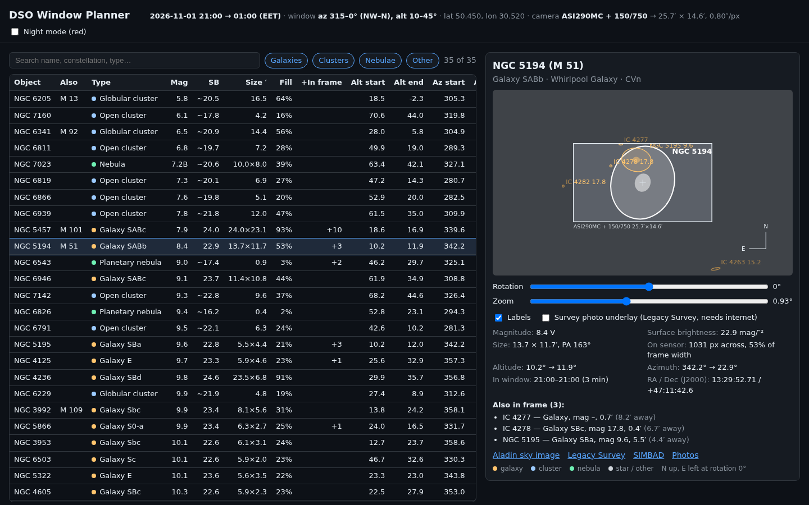
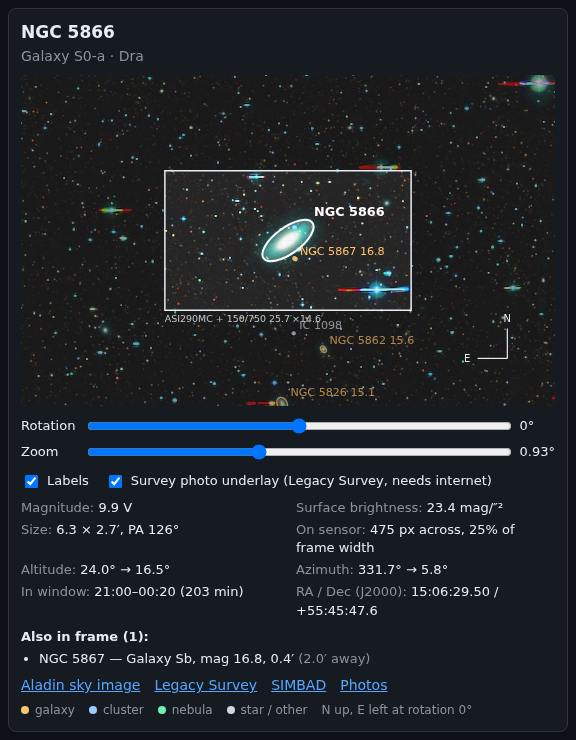

# DSO Window Planner

Finds NGC / IC / Messier objects that pass through a patch of sky (by default
**azimuth NW–N, altitude 10–45°**) during a time period, and shows how each one
fits in the camera frame (default: **ASI290MC on a 150 mm f/5 reflector**).



Needs Python 3.9+ and numpy. Catalog: [OpenNGC](https://github.com/mattiaverga/OpenNGC) (CC-BY-SA-4.0), in `data/`.

## Quick start

```sh
# first time: give your location once and save it (+N latitude, +E longitude)
./dso_window.py --lat 50.45 --lon 30.52 --tz Europe/Kyiv --save

# tonight 21:00 → 01:00, terminal table + interactive HTML report
./dso_window.py --from 21:00 --to 01:00 --html tonight.html

# a specific date, galaxies only, brighter than mag 11, longest in the window first
./dso_window.py --date 2026-11-14 --from 20:30 --to 23:00 --types galaxy --max-mag 11 --sort time
```

Open the HTML file in a browser and click any row to see it in the camera frame.

## What you get

| Column | Meaning |
|---|---|
| Type | galaxy / cluster / nebula (with subtype, e.g. *Galaxy SABc*, *Planetary nebula*) |
| Mag | V magnitude (`B` suffix = blue magnitude when V is unknown) |
| SB | surface brightness, mag/arcsec² (`~` = estimated from mag and size) |
| Size | major × minor axis, arcmin |
| Fill | major axis as % of the frame width |
| +Frm | other NGC/IC objects that also land in the frame |
| Alt/Az start, end | position at the start and end of the period |
| In window / Min | first–last time inside the window, and minutes spent there |

## HTML frame view

- Schematic of the object (true size and orientation) inside the 25.7′ × 14.6′ frame, with
  every other NGC/IC object nearby — galaxies, clusters, nebulae.
- **Rotation** slider = camera rotation; **Zoom** slider = field around the frame.
- Optional photo underlay (Legacy Survey) to compare with the real sky; links to Aladin, SIMBAD.
- **Night mode** turns everything red.
- Open a given object directly: `tonight.html#M 101`.



*NGC 5866 with the photo underlay on: the schematic outline matches the real galaxy.*

The page layout lives in `templates/report.html`.

## Useful options

| Option | Default | |
|---|---|---|
| `--az-from`, `--az-to` | `NW`, `N` | window edges, degrees or compass points, clockwise |
| `--alt-min`, `--alt-max` | 10, 45 | window altitude limits |
| `--whole` | off | only objects that stay in the window the whole period |
| `--min-minutes` | 0 | minimum time spent in the window |
| `--catalogs` / `--messier-only` | `ngc,ic,m` | catalogs to search |
| `--types` | `galaxy,cluster,nebula` | add `other` for stars etc. |
| `--max-mag`, `--max-sb`, `--min-size` | 12, –, 0 | brightness / size filters |
| `--no-mag` | off | also list objects with no catalog magnitude (many nebulae) |
| `--sort` | `mag` | `mag sb size name alt time enter` |
| `--csv FILE` | | save results as CSV |
| `--focal`, `--pixel`, `--sensor` | 750, 2.9, 1936x1096 | telescope/camera (can be saved in `config.json`) |

Run `./dso_window.py -h` for the full list. `./update_catalog.sh` refreshes the catalog.
